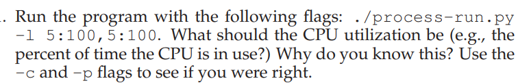

CPU Utilization
How much of the CPU time is actually being used.

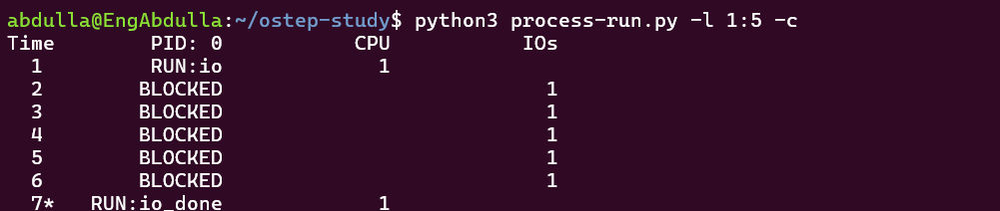
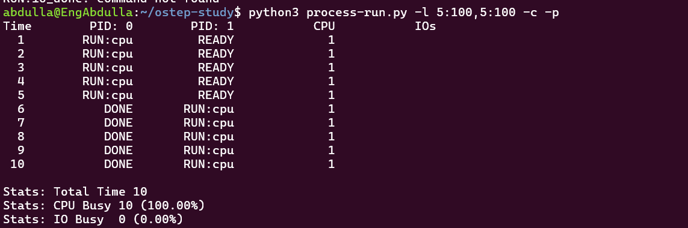

The CPU utilization should be 100%.
as not wait of i/o at process and have done all process for that reason 100%

==================================

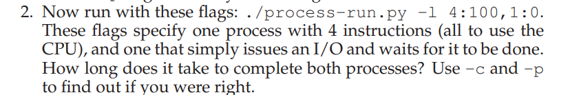
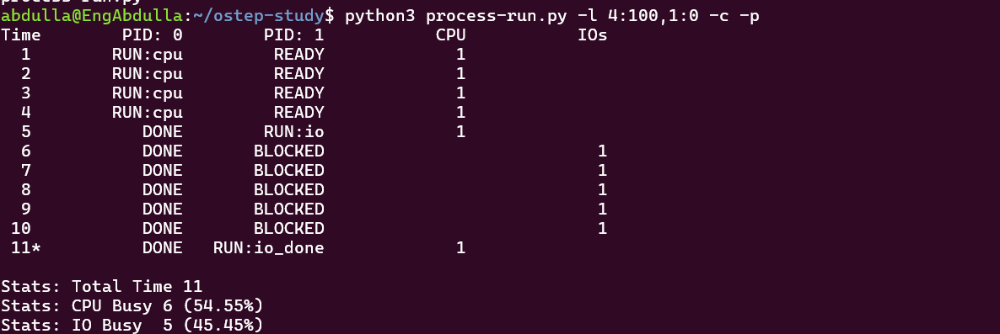

It takes 11 time complete processes

Process 0 needs 4 CPU time units Process 1 wait to I/O and then waits for 5 time units output confirms that the total time is 11

===================================

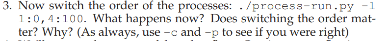
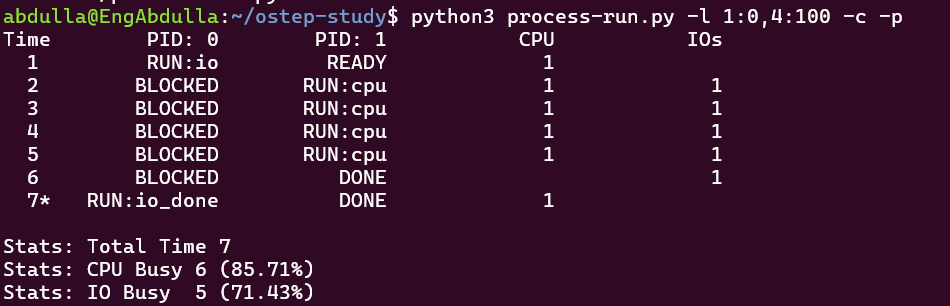

Yes switching the order matters When the I/O process runs first the CPU can run the other process while the first process is blocked waiting for I/O the total completion time decreases from 11 to 7 time units
note: when there is i/o the cpu use waiting time and run another porcess for that reason time decrease

====================================

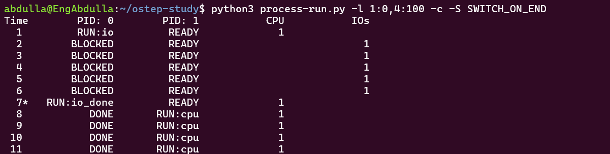
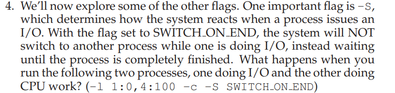

With SWITCH_ON_END the system does not switch to another process while the current process is doing I/O
SWITCH_ON_IO → use time and run another process
SWITCH_ON_END → run after finish process

====================================

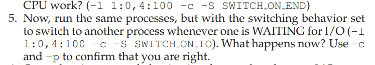
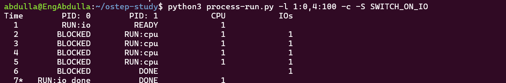

at here the task have been implemented as same time in parrell way as we have i/o and good use time

====================================

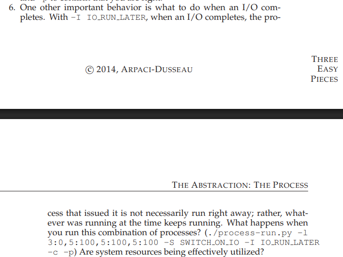
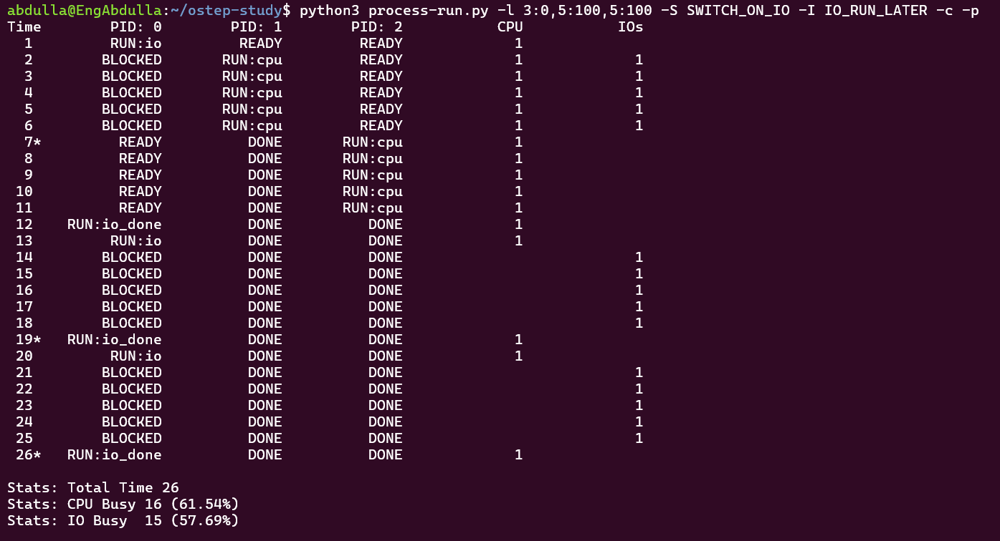

The system resources are not used efficiently When the I/O completes the process becomes READY but does not run immediately because of `IO_RUN_LATER`. It has to wait for its turn, which increases the total time.

The total time is **26 time units**.

=====================================
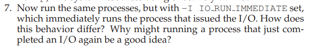
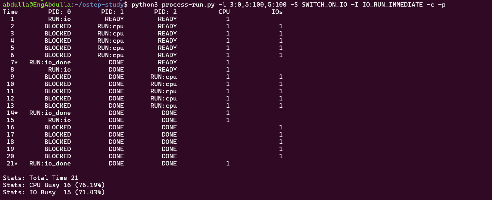

The total time is 21 time units. which we manage time Immediately run the process that has I/O

======================================
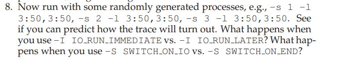

 IO_RUN_LATER I/O → BLOCKED → I/O finishes → READY queue IO_RUN_IMMEDIATE I/O → BLOCKED → I/O finishes → RUN immediate
