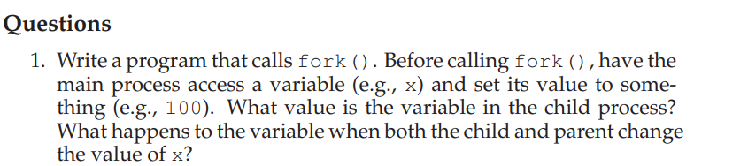

```cpp
#include <iostream>
#include <unistd.h>
using namespace std;

int main()
{

    int x = 100;
    int rc = fork();

    if (rc == 0)
    {
        // child
        x = 200;
        cout << x;
    }
    else
    {
        // parent
        cout << x;
    }
}

```
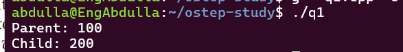


================================


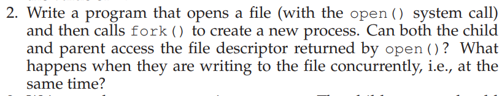

```cpp

#include <iostream>
#include <unistd.h>
#include <fcntl.h>
#include <unistd.h>
using namespace std;

int main()
{

    int fd = open("file.txt", O_WRONLY | O_CREAT, 0644);

    if (fd < 0)
    {
        cout << "open failed\n";
        return 1;
    }

    cout << "File descriptor: " << fd << endl;


    return 0;
}


```
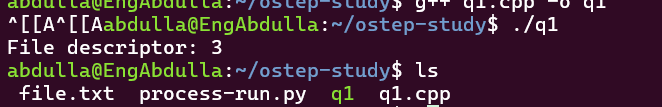

===================================
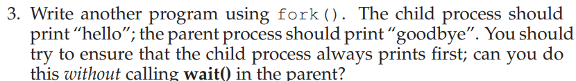
```cpp
#include <iostream>
#include <unistd.h>
using namespace std;

int main()
{

    int rc = fork();

    if (rc == 0)
    {
        // child
        cout << "Hello" << endl;
    }
    else
    {
        // parent
        // to ensure the child print first
        sleep(1);
        cout << "World" << endl;
    }
}
```
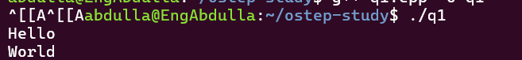
==================================


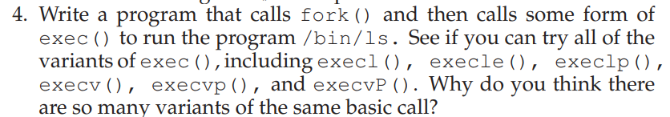
```cpp
#include <iostream>
#include <unistd.h>
using namespace std;

int main()
{
    int rc = fork();

    if (rc == 0)
    {
        // child
        execl("/bin/ls", "ls", NULL);

        // only runs if exec fails
        cout << "exec failed" << endl;
    }
    else
    {
        // parent
        cout << "I am parent" << endl;
    }

    return 0;
}
```
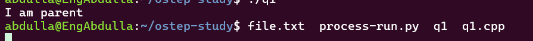
==================================


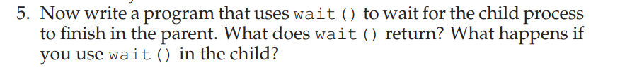
```cpp

#include <iostream>
#include <unistd.h>
#include <sys/wait.h>
using namespace std;

int main()
{
    int rc = fork();

    if (rc == 0)
    {
        // child
        cout << "I am child" << endl;
    }
    else
    {
        // parent
        wait(NULL);
        cout << "I am parent" << endl;
    }

    return 0;
}
// as when put wait at parent == > child will excute first and after parent 
// but if i have put at child == > parent will excute first and after child 
```
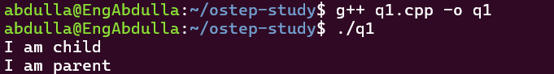
==================================


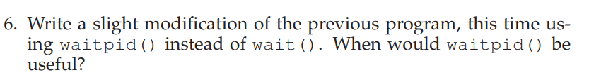
```cpp

#include <iostream>
#include <unistd.h>
#include <sys/wait.h>
using namespace std;

int main()
{
    int rc = fork();

    if (rc == 0)
    {
        // child
        cout << "I am child" << endl;
    }
    else
    {
        // parent
        waitpid(rc, NULL, 0);
        // rc = PID of Child 
        // which is process identifer of child pid 
        // that be usful when parent have more than one child 
        cout << "I am parent" << endl;
    }

    return 0;
    // useful when the parent has multiple children
    // because waitpid() can wait for a specific child using its PID
}
```
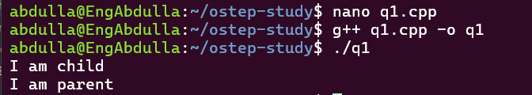
==================================


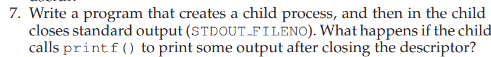
```cpp

#include <iostream>
#include <unistd.h>
#include <cstdio>
using namespace std;

int main()
{
    int rc = fork();

    if (rc == 0)
    {
        // child
        printf("Hello from child before close \n");

        close(STDOUT_FILENO);
            // will not appear 
        printf("Hello from child\n");
    }
    else
    {
        // parent
        cout << "I am parent" << endl;
    }

    return 0;
}
```
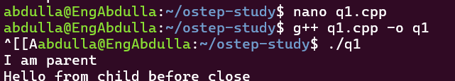
==================================


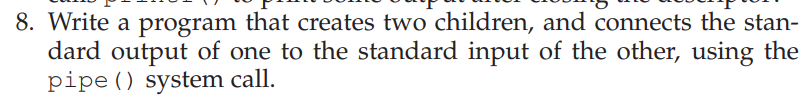
```cpp
\#include \<iostream>
\#include \<unistd.h>
\#include \<sys/wait.h>
using namespace std;

int main()
{
    int pipefd[2];

*&#xA0;   // create pipe*
    pipe(pipefd);

*&#xA0;   // create first child*
    int child1 = fork();

    if (child1 == 0)
    {
*&#xA0;       // Child 1*

*&#xA0;       // stdout → pipe*
        dup2(pipefd[1], STDOUT_FILENO);

        close(pipefd[0]);
        close(pipefd[1]);

        cout << "Hello from Child 1" << endl;

        return 0;
    }

*&#xA0;   // create second child*
    int child2 = fork();

    if (child2 == 0)
    {
*&#xA0;       // Child 2*

*&#xA0;       // stdin ← pipe*
        dup2(pipefd[0], STDIN_FILENO);

        close(pipefd[0]);
        close(pipefd[1]);

        char buffer[100];

        cin.getline(buffer, 100);

        cout << "Child 2 received: " << buffer << endl;

        return 0;
    }

*&#xA0;   // Parent*
    close(pipefd[0]);
    close(pipefd[1]);

    waitpid(child1, NULL, 0);
    waitpid(child2, NULL, 0);

    return 0;
}

```
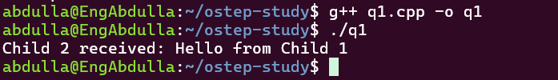
==================================


