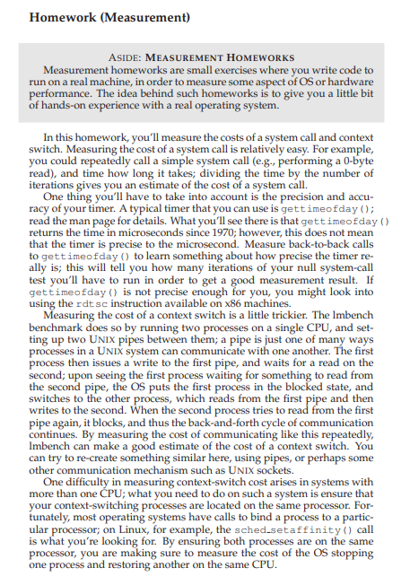
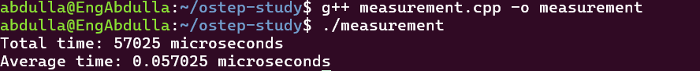
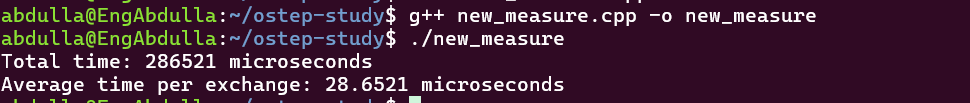

System Call = when a process needs a service/resource from the OS.

just the structer now the start time 
and end time and get total time and divide over number of iteration 
give me average of one system call()
```cpp
#include <iostream>
#include <sys/time.h>
#include <unistd.h>

using namespace std;

int main()
{
    int iterations = 1000000;

    struct timeval start;
    gettimeofday(&start, NULL);

    for (int i = 0; i < iterations; i++)
    {
        getpid();
    }

    struct timeval end;
    gettimeofday(&end, NULL);

    long long start_us =
        start.tv_sec * 1000000LL + start.tv_usec;

    long long end_us =
        end.tv_sec * 1000000LL + end.tv_usec;

    long long total_time = end_us - start_us;

    cout << "Total time: " << total_time << " microseconds" << endl;
    cout << "Average time: "
         << (double)total_time / iterations
         << " microseconds" << endl;

    return 0;
}
```



=============================
// pipe communication between process 
// fork create new process 
// now   i need to majour the context switch between process 
// communication between Parent and Child
// create two piped can communcation between parent and child and child with parent


```cpp
#include <iostream>
#include <sys/time.h>
#include <unistd.h>
#include <sys/wait.h>

using namespace std;

int main()
{
    int iterations = 10000;

    int pipe1[2]; // Child -> Parent
    int pipe2[2]; // Parent -> Child

    pipe(pipe1);
    pipe(pipe2);

    int rc = fork();

    if (rc == 0)
    {
        // Child

        char buffer;

        for (int i = 0; i < iterations; i++)
        {
            // Child -> Parent
            write(pipe1[1], "x", 1);

            // Wait for Parent
            read(pipe2[0], &buffer, 1);
        }
    }
    else
    {
        // Parent

        char buffer;

        struct timeval start, end;

        gettimeofday(&start, NULL);

        for (int i = 0; i < iterations; i++)
        {
            // Wait for Child
            read(pipe1[0], &buffer, 1);

            // Parent -> Child
            write(pipe2[1], "x", 1);
        }

        gettimeofday(&end, NULL);

        long long start_us =
            start.tv_sec * 1000000LL + start.tv_usec;

        long long end_us =
            end.tv_sec * 1000000LL + end.tv_usec;

        long long total_time = end_us - start_us;

        cout << "Total time: "
             << total_time
             << " microseconds" << endl;

        cout << "Average time per exchange: "
             << (double)total_time / iterations
             << " microseconds" << endl;

        wait(NULL);
    }

    return 0;
}
```

