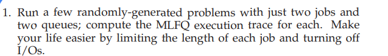


conclusion
MLFQ gives new jobs high priority. Jobs that use the full CPU time allocation move to lower-priority queues, while short jobs can finish quickly at higher priority.


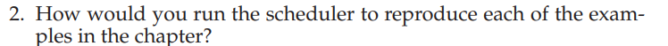
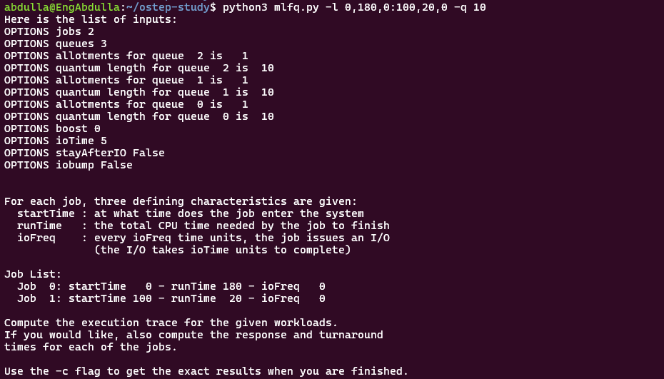

- Job 0 arrives at time 0 and needs 180 CPU units.
- Job 1 arrives at time 100 and needs 20 CPU units.
- Both jobs have no I/O.
- There are 3 priority queues.
- Each queue has a 10-unit quantum.

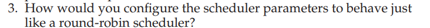
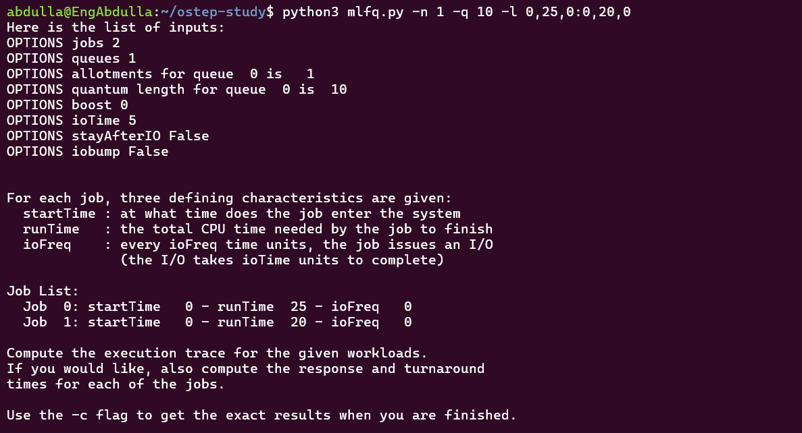

### Question 3 – Configure MLFQ as Round Robin

To make MLFQ behave like Round Robin, I used only one queue and set a fixed time quantum.

Command:

```bash
python3 mlfq.py -n 1 -q 10 -l 0,25,0:0,20,0
```

- Number of queues = 1.
- Time quantum = 10.
- Job 0 needs 25 CPU units.
- Job 1 needs 20 CPU units.

**Execution Trace:**

- 0–10: Job 0
- 10–20: Job 1
- 20–30: Job 0
- 30–40: Job 1
- 40–45: Job 0

**Conclusion:**

Using one queue removes priority differences between jobs. All jobs share the same priority and execute in Round Robin order using the same time quantum.


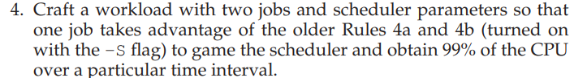
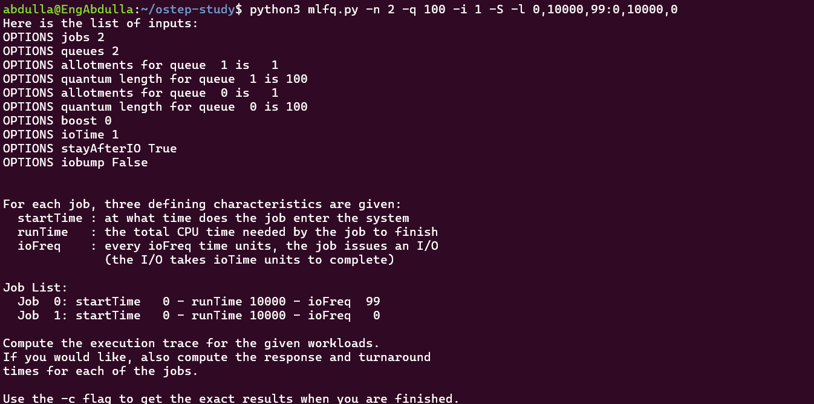


Job 0 uses 99 CPU units, then waits 1 unit for I/O.

CPU usage ratio = 99 / (99 + 1) = 99%.

Job 0 keeps its high priority under the old rules.

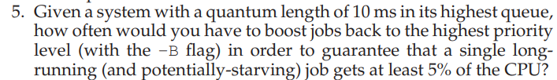

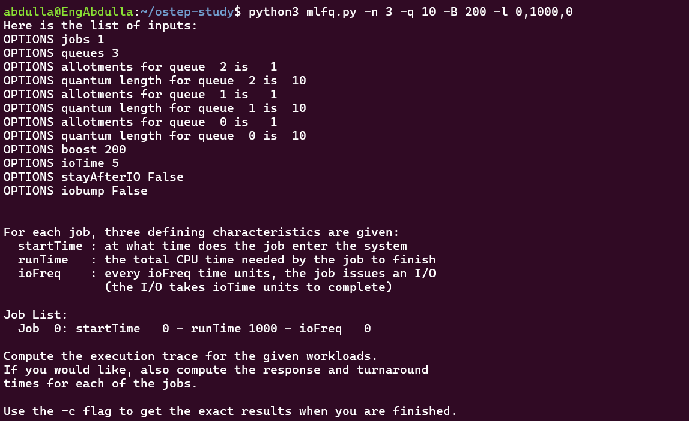
Set the boost interval to 200 ms (-B 200).

A long-running job gets 10 ms of CPU every 200 ms, which equals 5% of CPU time, assuming it receives a full quantum each cycle.


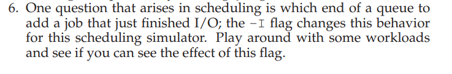
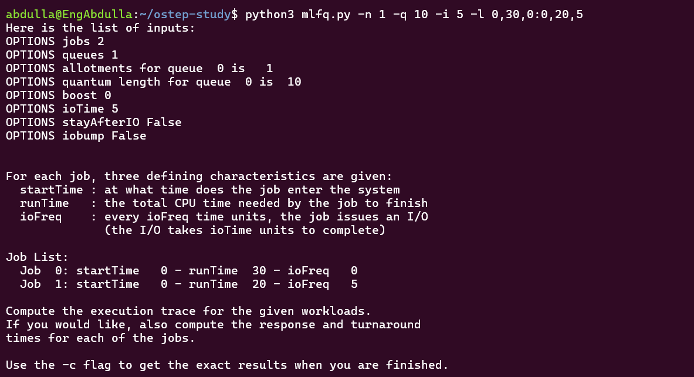

 -I flag changes the position of jobs after completing I/O. This affects the execution order and scheduling fairness