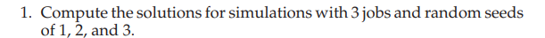
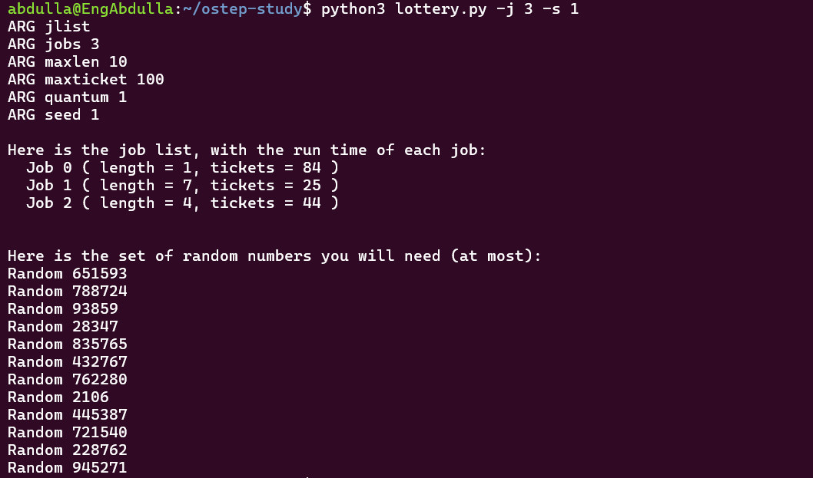
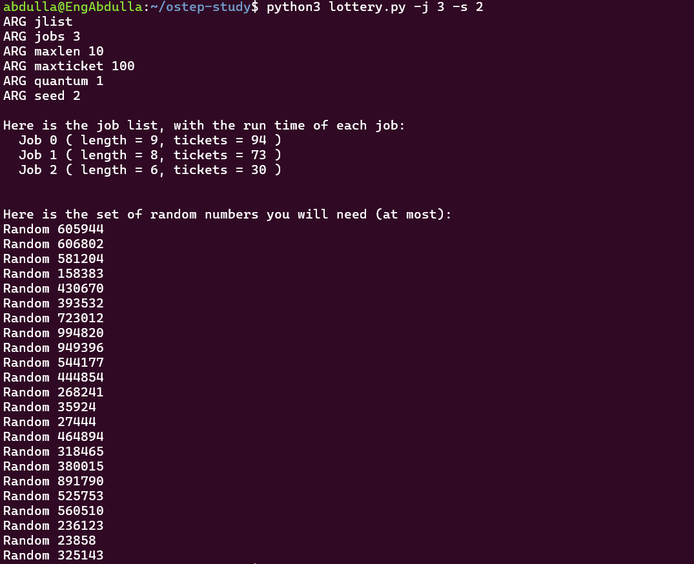
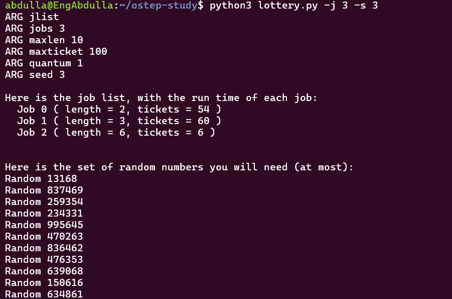

### Question 1 - Random Seeds

- Ran the simulation with 3 jobs using seeds 1, 2, and 3.
- Different seeds generate different random workloads.
- The number of tickets assigned to each process changes.
- The random numbers also change, so the lottery results may be different.
- More tickets → Higher chance of winning.
- However, winning is not guaranteed because Lottery Scheduling is probabilistic.

**Conclusion:** Changing the random seed affects the workload and the scheduling results.

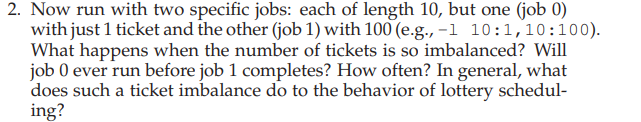

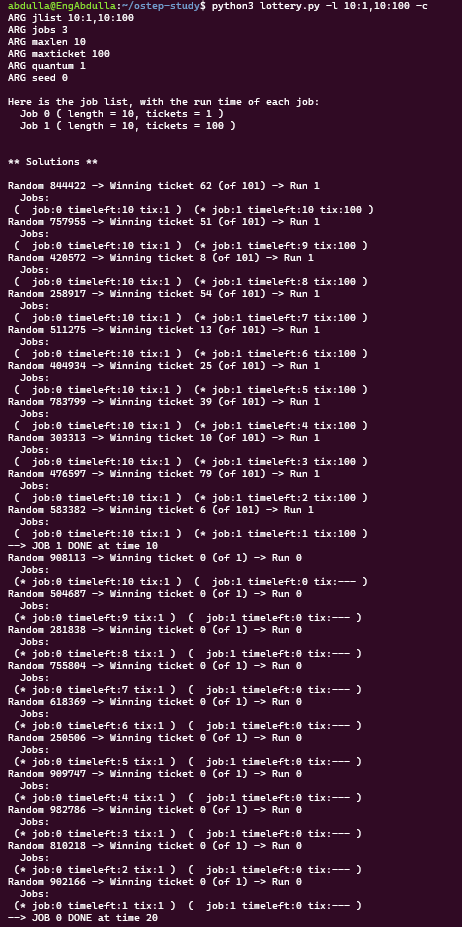
### Question 2 - Ticket Imbalance

- Job 0: 10 length, 1 ticket.
- Job 1: 10 length, 100 tickets.
- Job 1 won all first 10 lotteries.
- Job 0 did not run before Job 1 completed.
- Job 1 finished at time 10.
- Job 0 started after Job 1 finished and completed at time 20.

**Conclusion:**
- More tickets → Higher chance of getting CPU.
- A large ticket imbalance can make a job wait for a long time.
- Lottery Scheduling does not guarantee that every job gets CPU quickly.

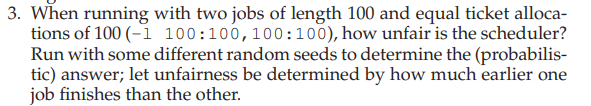
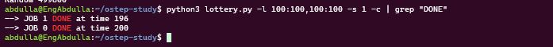
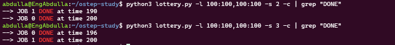

## Question 3 - Lottery Fairness

- Job 0: 100 length, 100 tickets.
- Job 1: 100 length, 100 tickets.
- Both jobs have equal tickets (50% chance each).

**Results:**

| Seed | First Finish | Second Finish | Unfairness |
|---|---:|---:|---:|
| 1 | 196 | 200 | 0.98 |
| 2 | 190 | 200 | 0.95 |
| 3 | 196 | 200 | 0.98 |

**Conclusion:**
- Equal tickets do not guarantee that both jobs finish at the same time.
- Lottery Scheduling is random.
- Different seeds produce different results.
- U close to 1 → Better fairness.
- Longer jobs generally give the scheduler more chances to approach the expected CPU share.
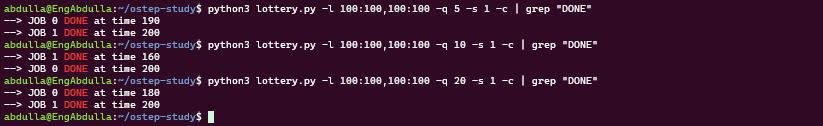
Increasing Quantum means each process gets more CPU time per lottery win.

Fewer lottery rounds are needed to finish jobs.

Larger Quantum may increase unfairness because each win has a bigger impact on job completion time.

Smaller Quantum provides more lottery rounds and more chances to balance CPU sharing.

Conclusion: Quantum size affects how fairly Lottery Scheduling distributes CPU time between jobs.

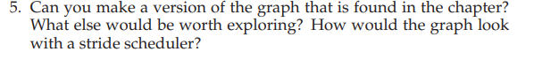
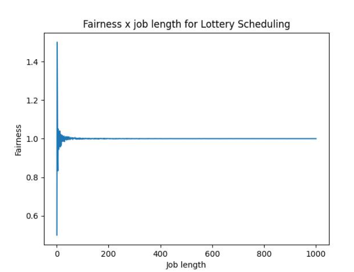
### Question 5 - Graph and Further Exploration

- Create a graph similar to Figure 9.2.
- X-axis → Job Length.
- Y-axis → Average Unfairness.
- Explore different ticket allocations, quantum sizes, and number of jobs.

**Stride Scheduling:**
- Stride is deterministic, unlike Lottery Scheduling.
- It provides more consistent CPU sharing.
- Its graph is expected to be closer to perfect fairness (U = 1).

**Conclusion:**
Compare Lottery and Stride to understand how each algorithm affects fairness.