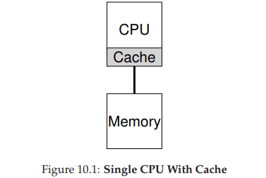
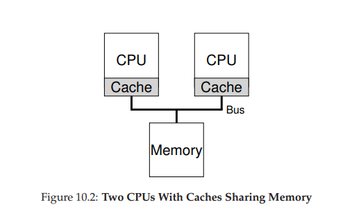

# Chapter 10: Multiprocessor Scheduling (Advanced)

## Main Idea

- Modern computers have multiple CPU cores.
- Increasing the speed of a single CPU became difficult due to power and heat limitations.
- Multiple cores allow us to execute tasks in parallel.
- The OS needs to schedule jobs across multiple CPUs.

## Main Problem

- Having multiple CPU cores does not automatically make programs faster.
- A single-threaded application can execute on only one core at a time.
- To benefit from multiple cores, applications need parallelism.

## Solution

- Use multithreading to divide work into multiple threads.
- Threads can run on different CPU cores.
- This helps applications use CPU resources more efficiently.

---

## 10.1 Background: Multiprocessor Architecture

### Main Question

- How should the OS schedule jobs on multiple CPUs?
- Do old scheduling techniques still work?

### Single CPU Architecture

- CPU (Central Processing Unit): Executes instructions.
- Cache: Small and fast memory that stores copies of recently used data.
- Main Memory (RAM): Stores running programs and their data.
- Cache is smaller and faster than RAM.
- RAM has a larger capacity but is slower than cache.

### Cache

- Cache helps the CPU access data faster.
- Cache Hit: Requested data is found in cache.
- Cache Miss: Requested data is not found in cache, so it must be fetched from a lower memory level.

### Multiprocessor Architecture

- Each CPU core may have its own private cache.
- All CPUs share the same main memory.
- CPUs communicate with memory through a shared bus (in the architecture shown in the book).

### Cache Locality

Two types of locality:

**1. Temporal Locality**
- Recently accessed data may be accessed again soon.
- Example: Reusing a variable inside a loop.

**2. Spatial Locality**
- Nearby memory locations are likely to be accessed soon.
- Example: Accessing array elements one after another.

### Cache Coherence Problem

- Multiple CPU caches may contain copies of the same memory location.
- CPU 1 reads data into its cache.
- CPU 1 modifies the data in its cache.
- With a write-back cache, main memory may still contain the old value.
- CPU 2 may read an outdated copy if cache coherence is not maintained.
- Different caches must maintain a consistent view of shared data.

### Cache Coherence Solution: Bus Snooping

- Hardware monitors memory transactions through the shared bus.
- Each cache watches the bus for relevant memory operations.
- When a CPU modifies data, other caches detect the change.

Two approaches:

**1. Invalidate**
- Mark old cache copies as invalid.
- Other CPUs must obtain a valid copy before using the data again.

**2. Update**
- Send the new value to other caches.
- Their cached copies are updated.

---

## 10.2 Don't Forget Synchronization

- Cache coherence does not prevent race conditions.
- Multiple threads may access shared data at the same time.
- Concurrent operations can produce incorrect results or data corruption.
- Shared data structures need proper synchronization.

### Synchronization

- Use locks to protect shared data.
- Mutual Exclusion allows only one thread to enter a critical section at a time.
- A critical section is the part of code that accesses shared data.

### Synchronization Example: Linked List

- `List_Pop()` removes the head node.
- Multiple threads may execute it simultaneously.
- Both threads may read the same head node.
- One thread may free the node while the other still uses it.
- This can cause:
  - Double Free.
  - Use-After-Free.
  - Memory Corruption.

**Solution: Mutex**

- Lock before accessing shared data.
- Perform the complete operation inside the critical section.
- Unlock after finishing.
- This prevents concurrent unsafe modifications.

---

## 10.3 One Final Issue: Cache Affinity

### Main Idea

- A process may build useful data in a CPU's cache.
- Moving it to another CPU may cause additional cache misses.
- The new CPU may not have the required data in its local cache.

### Cache Affinity

- Prefer running a process on the same CPU when possible.
- Reuse cached data.
- Reduce unnecessary cache misses.
- Improve performance.

**Important:**
- Cache Affinity is a preference, not a strict rule.
- The scheduler may move processes to balance the workload.

---

## 10.4 Single-Queue Scheduling (SQMS)

### Main Idea

- All CPUs share one ready queue.
- The scheduler selects jobs from the same queue.
- Available CPUs take jobs from this shared queue.
- Existing scheduling policies can be adapted.

### Example

- One shared queue contains A, B, C, D, and E.
- All CPUs select jobs from this queue.
- Each CPU executes the selected job for its time slice.

### Advantages

- Simple design.
- Easy to implement.
- Easy to adapt existing scheduling policies.
- Jobs can be distributed among available CPUs.

### SQMS Shortcomings

**1. Lack of Scalability**

- All CPUs share one ready queue.
- A lock protects the shared queue.
- Only one CPU can modify the queue at a time.
- Other CPUs may wait for the lock.
- Lock contention increases with more CPUs.
- This reduces performance.

**2. Poor Cache Affinity**

- Jobs may move between different CPUs.
- Each CPU has its own cache.
- Moving a job may cause additional cache misses.
- This reduces cache efficiency.

### Improving Cache Affinity

- Keep jobs on the same CPU when possible.
- Use an affinity mechanism.
- Some jobs may move to balance the workload.

### Main Trade-off

- Cache Affinity: Keep jobs close to their cached data.
- Load Balancing: Distribute work across CPUs.
- The scheduler should balance both goals.

---

## 10.5 Multi-Queue Scheduling (MQMS)

### Main Idea

- Use multiple scheduling queues instead of one shared queue.
- Each CPU has its own queue.
- Each job is placed in exactly one queue.
- Each queue uses its own scheduling policy.
- Queues operate independently.

### Example

- Queue 0: A, C → CPU 0.
- Queue 1: B, D → CPU 1.
- Each CPU schedules jobs from its own queue.

### Queue Assignment

- The OS decides which queue receives a new job.
- Possible assignment heuristics:
  - Random assignment.
  - Choose the queue with fewer jobs.

### Scheduling Policy

- Each queue can use Round Robin or another scheduling policy.
- Queues schedule their jobs independently.

### Advantages

**1. Better Scalability**

- CPUs access separate queues.
- Less contention on shared locks.
- More queues can be used as the number of CPUs increases.

**2. Better Cache Affinity**

- Jobs tend to stay on the same CPU.
- Better reuse of cached data.
- Less unnecessary migration.

### MQMS Problem: Load Imbalance

- Each CPU has its own scheduling queue.
- Jobs may finish at different times.
- This can create an unbalanced workload.

### Example

Initially:

- Queue 0: A, C.
- Queue 1: B, D.

After job C finishes:

- Queue 0: A.
- Queue 1: B, D.

After job A finishes:

- Queue 0 becomes empty.
- Queue 1 still has B and D.
- CPU 0 becomes idle.
- CPU 1 is still busy.

### Load Imbalance

- Work is not distributed evenly across CPUs.
- Some CPUs may be idle while others are busy.
- This reduces overall CPU utilization.

### Load Balancing Through Migration

- Migration: Move jobs between CPU queues.
- Helps distribute work across CPUs.
- An idle CPU can receive jobs from a busy CPU.
- Migration may happen more than once.

### Continuous Migration

- Sometimes one migration is not enough.
- The scheduler may move jobs multiple times.
- Goal: Keep CPUs balanced.

### Work Stealing

- A CPU with few jobs checks another CPU's queue.
- If the other queue is much fuller, it steals one or more jobs.
- Helps reduce idle CPU time.
- Improves load balancing.

### Work Stealing Trade-off

**Checking too frequently:**
- More overhead.
- Less time for actual work.

**Checking too infrequently:**
- CPUs may remain idle.
- Load imbalance continues.

- The scheduler must balance checking overhead and load balancing.

### Main Trade-off

- Cache Affinity: Avoid unnecessary job migration.
- Load Balancing: Move jobs when needed.
- The scheduler must balance both goals.

---

## 10.6 Linux Multiprocessor Schedulers

The book discusses three scheduling approaches:

### 1. O(1) Scheduler

- Uses multiple queues.
- Priority-based scheduling.
- Priorities may change over time.
- Focuses on responsiveness and interactive applications.
- Selects the next job in constant time (O(1)).

### 2. Completely Fair Scheduler (CFS)

- Uses multiple per-CPU run queues.
- Deterministic proportional-share scheduling.
- Tries to distribute CPU time fairly among processes.
- Tracks how much CPU time each process receives.

### 3. BFS Scheduler

- Uses a single queue.
- Proportional-share scheduling.
- Uses EEVDF (Earliest Eligible Virtual Deadline First), as described in the book.

### Comparison

| Scheduler | Queue Structure | Scheduling Approach |
|---|---|---|
| O(1) | Multiple Queues | Priority-based |
| CFS | Multiple Queues | Fair proportional-share |
| BFS | Single Queue | Proportional-share / EEVDF |

**Note:**
- This comparison follows the historical schedulers discussed in OSTEP.
- It should not be treated as a complete description of modern Linux scheduling.

---

## 10.7 Summary

### SQMS (Single-Queue Multiprocessor Scheduling)

**Advantages:**
- Simple design.
- Easy to implement.
- Easier load balancing.

**Disadvantages:**
- Lock contention.
- Poor scalability.
- Poor cache affinity.

### MQMS (Multi-Queue Multiprocessor Scheduling)

**Advantages:**
- Better scalability.
- Better cache affinity.
- Independent scheduling queues.

**Disadvantages:**
- Load imbalance.
- More complex design.
- Requires migration and work stealing.

### Main Takeaways

- SQMS uses one shared queue for all CPUs.
- MQMS uses separate queues for different CPUs.
- SQMS is simple but has scalability and cache affinity problems.
- MQMS scales better but can suffer from load imbalance.
- Migration and work stealing help balance workloads.
- Cache Affinity and Load Balancing are important scheduling goals.
- No scheduling approach is perfect.
- The best design depends on system requirements.

---

## Important Terms

| Term | Meaning |
|---|---|
| Multiprocessor | System with multiple CPUs or cores |
| Cache Hit | Requested data is found in cache |
| Cache Miss | Requested data is not found in cache |
| Temporal Locality | Reusing recently accessed data |
| Spatial Locality | Accessing nearby memory locations |
| Cache Coherence | Maintaining consistent cached copies |
| Bus Snooping | Monitoring bus transactions |
| Invalidate | Mark a cached copy as invalid |
| Synchronization | Coordinating concurrent access |
| Mutex | Lock for mutual exclusion |
| Race Condition | Result depends on timing/interleaving |
| Cache Affinity | Prefer the same CPU for a process |
| SQMS | Single-Queue Multiprocessor Scheduling |
| MQMS | Multi-Queue Multiprocessor Scheduling |
| Lock Contention | CPUs competing for the same lock |
| Load Imbalance | Uneven workload across CPUs |
| Migration | Moving a job between CPU queues |
| Work Stealing | Taking jobs from a busier queue |
| Load Balancing | Distributing work across CPUs |
