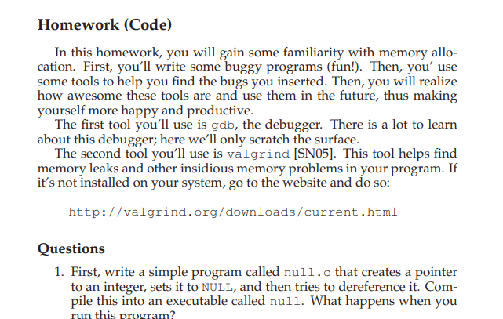
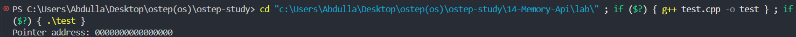
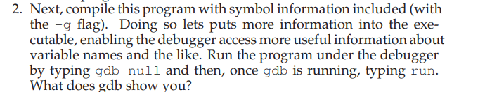
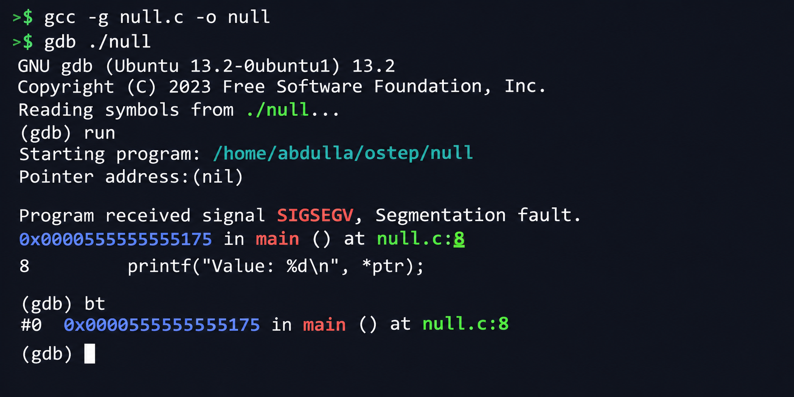
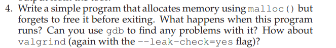
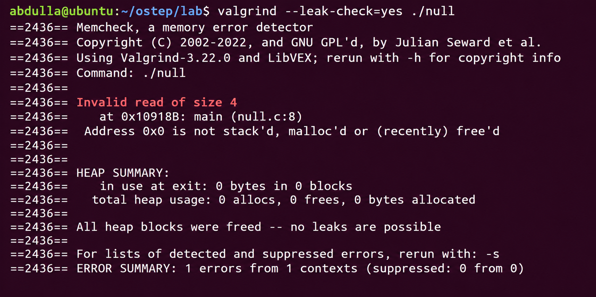
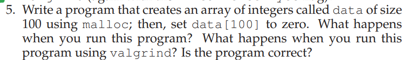

```cpp

#include <stdio.h>

int main() {
    int *ptr = NULL;

    printf("Pointer address: %p\n", (void *)ptr);

    printf("Value: %d\n", *ptr);

    return 0;
}
```


when we create a pointer and intilized to null and then we print it which is zero and programmer crash access to it invalid memroy address 

Dereferencing a NULL pointer causes undefined behavior
and commonly results in a segmentation fault or access violation.

================================================




GDB showed a segmentation fault because the program tried to dereference a NULL pointer.
It also showed the exact line where the error happened.





==============================================

same reason like prev question 


=============================================
 


```cpp

#include <stdio.h>
#include <stdlib.h>

int main() {
    int *data = malloc(100 * sizeof(int));

    if (data == NULL) {
        return 1;
    }

    data[100] = 0;  // Out of bounds access

    printf("Program finished.\n");

    free(data);

    return 0;
}
```
as out of size of array 
 
============================================
